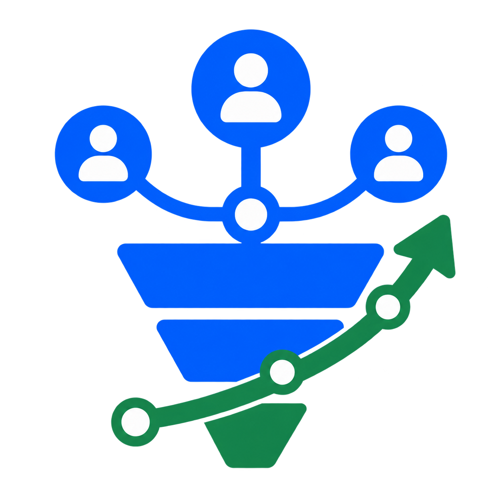
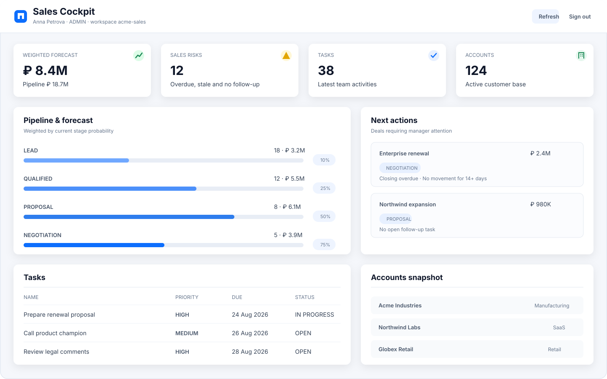
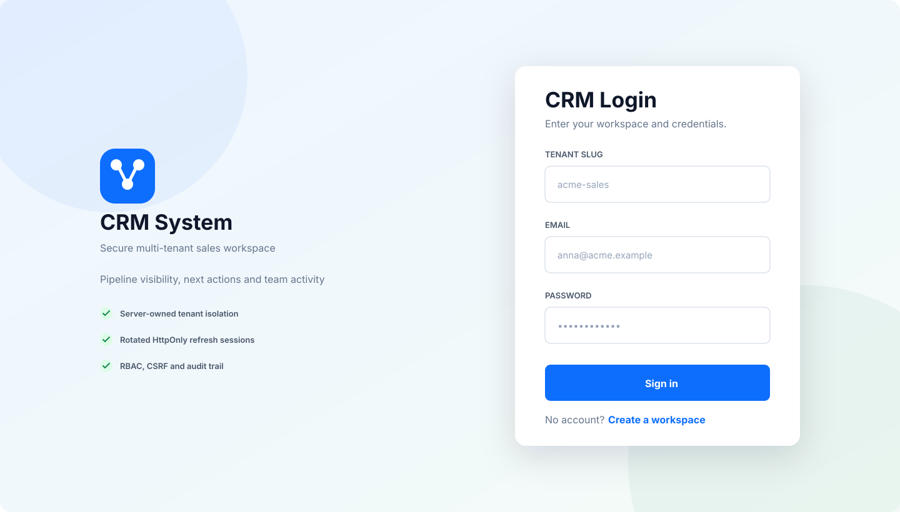
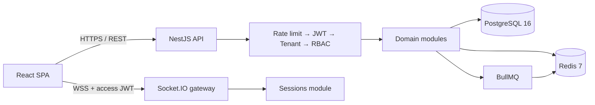
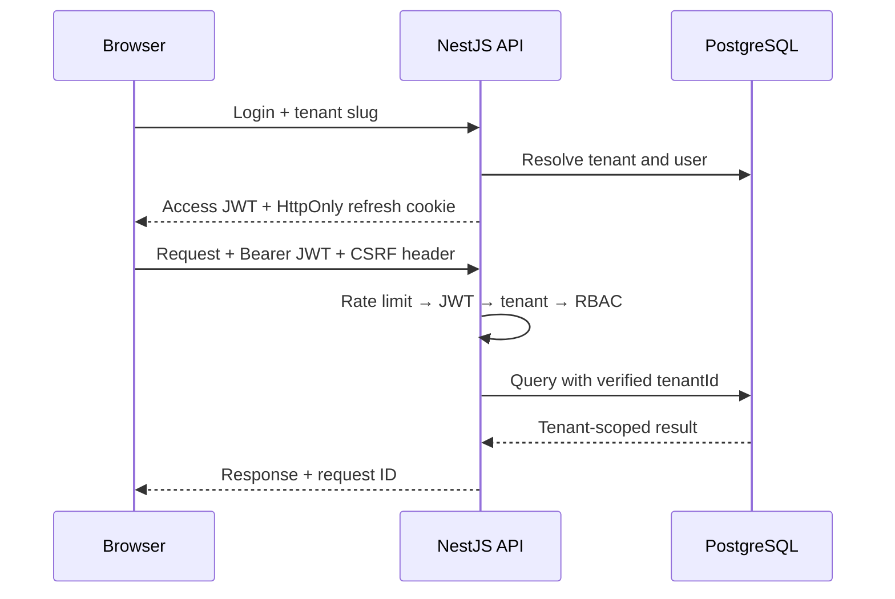

<div align="center">
  
  <h1>CRM System</h1>
  <p><strong>Безопасная multi-tenant CRM для управления воронкой, прогнозом и действиями команды.</strong></p>
  <p>React sales cockpit · NestJS API · PostgreSQL · Redis · BullMQ · WebSocket</p>

  <p>
    <a href="https://github.com/minkinad/crm-system/actions/workflows/ci.yml"></a>
    <a href="https://github.com/minkinad/crm-system/actions/workflows/codeql.yml"></a>
    
    
    <a href="LICENSE"></a>
  </p>

  <p>
    <a href="#quick-start">Быстрый старт</a> ·
    <a href="#features">Возможности</a> ·
    <a href="#architecture">Архитектура</a> ·
    <a href="#security">Безопасность</a> ·
    <a href="#faq">FAQ</a> ·
    <a href="docs/README.md">Документация</a>
  </p>
</div>

---

CRM System — production-oriented модульный монолит для B2B-продаж. Он объединяет данные по
клиентам и сделкам, weighted forecast, риски воронки, follow-up задачи, realtime-события и аудит.
Tenant определяется только проверенной сервером identity, а HTTP API закрыт по умолчанию.

> **Статус:** активная разработка. Security foundation, миграции и CI готовы; перед реальным
> production-развёртыванием настройте backups, observability, ingress и secret management.

<a id="screenshots"></a>

## Интерфейс

Превью ниже отображают текущую структуру React-экранов с демонстрационными данными.

### Sales cockpit



<details>
  <summary><strong>Экран входа</strong></summary>
  <br />
  
</details>

<a id="features"></a>

## Возможности

| Область          | Что реализовано                                                                      |
| ---------------- | ------------------------------------------------------------------------------------ |
| Sales cockpit    | Weighted forecast, pipeline summary по валютам, risk counters и next actions         |
| CRM data         | Accounts, contacts, deals, история стадий, задачи и комментарии                      |
| Командная работа | Роли Admin / Manager / Sales / Viewer, realtime tenant rooms, reminders через BullMQ |
| Поиск и обмен    | Фильтрация, пагинация, CSV-экспорт контактов и сделок                                |
| Multi-tenancy    | Server-owned tenant context и tenant predicate на persistence boundary               |
| Сессии           | Короткий access JWT в памяти, rotated refresh cookie, reuse detection и отзыв сессий |
| Governance       | Audit trail, request IDs, ADR, runbook, security policy и agent guides               |
| Operations       | Readiness/liveness, Docker health checks, migrations и graceful shutdown             |

### Для менеджера продаж

- прогноз выручки с вероятностью по каждой стадии;
- быстрый обзор stale и просроченных сделок;
- приоритизация сделок без открытого follow-up;
- единый экран задач, accounts snapshot и следующих действий;
- история переходов сделки и оперативные realtime-обновления.

### Для инженерной команды

- strict TypeScript на frontend и backend;
- NestJS-модули с явными application services и repository ports;
- глобальная цепочка guards: rate limit → JWT → tenant context → RBAC;
- PostgreSQL как source of truth, Redis для rate limits, cache versions и BullMQ;
- CI, CodeQL, dependency review, npm audit и Dependabot.

<a id="architecture"></a>

## Архитектура



Проект остаётся модульным монолитом: это сохраняет локальные транзакции и простой deployment,
но границы доменов уже оформлены для будущего разделения. Например, `deals` читает активность
задач через отдельный port, а session persistence принадлежит только модулю `sessions`.

```text
crm-system/
├── backend/                 NestJS API и background processor
│   └── src/
│       ├── common/          Guards, middleware, pipes, filters
│       ├── database/        Redis lifecycle, TypeORM datasource, migrations
│       └── modules/         Auth, sessions, CRM domains, audit, queues, realtime
├── frontend/                React SPA, auth state, API client, pages
├── docs/
│   ├── adr/                 Architecture Decision Records
│   ├── assets/              README visuals
│   └── operations/          Production runbook
└── docker-compose.yml       PostgreSQL, Redis, backend и frontend
```

Подробности: [Architecture](docs/ARCHITECTURE.md) · [ADR](docs/adr/README.md).

### Технологии

| Слой     | Стек                                               |
| -------- | -------------------------------------------------- |
| Frontend | React 18, Vite, MUI, React Query, Zustand, Axios   |
| Backend  | NestJS 11, TypeORM, Passport JWT, Socket.IO        |
| Data     | PostgreSQL 16, Redis 7                             |
| Async    | BullMQ delayed jobs                                |
| Delivery | Docker Compose, nginx, GitHub Actions, Dependabot  |
| Quality  | ESLint, Jest, TypeScript strict, CodeQL, npm audit |

<a id="quick-start"></a>

## Быстрый старт

### Требования

- Node.js 22 и npm;
- Docker Engine / Docker Desktop с Compose;
- свободные порты `3000`, `5173`, `5432` и `6379`.

### Docker Compose

```bash
git clone https://github.com/minkinad/crm-system.git
cd crm-system
cp .env.example .env

# Сначала поднимаем зависимости и применяем схему.
docker compose up -d postgres redis
npm --prefix backend ci
POSTGRES_HOST=127.0.0.1 npm --prefix backend run migration:run

# Затем запускаем приложение.
docker compose up -d --build backend frontend
```

После запуска:

| Сервис    | URL                                       |
| --------- | ----------------------------------------- |
| Frontend  | http://localhost:5173                     |
| REST API  | http://localhost:3000/api/v1              |
| Swagger   | http://localhost:3000/api/docs            |
| Readiness | http://localhost:3000/api/v1/health/ready |
| Liveness  | http://localhost:3000/api/v1/health/live  |

Откройте `/register`, создайте workspace и первого администратора. Предустановленных логинов и
паролей нет.

> Миграции намеренно не запускаются автоматически каждым API-контейнером. В production их должен
> выполнять отдельный release job после backup и проверки lock/downtime characteristics.

### Локальная разработка

Поднимите PostgreSQL и Redis, затем запустите приложения в отдельных терминалах:

```bash
docker compose up -d postgres redis

cp backend/.env.example backend/.env
# Для локального backend установите POSTGRES_HOST=127.0.0.1 и REDIS_HOST=127.0.0.1.
npm --prefix backend ci
POSTGRES_HOST=127.0.0.1 npm --prefix backend run migration:run
POSTGRES_HOST=127.0.0.1 REDIS_HOST=127.0.0.1 npm --prefix backend run start:dev
```

```bash
cp frontend/.env.example frontend/.env
npm --prefix frontend ci
npm --prefix frontend run dev
```

### Основные команды

```bash
# Backend
npm --prefix backend run build
npm --prefix backend run lint
npm --prefix backend test -- --runInBand
npm --prefix backend run migration:run

# Frontend
npm --prefix frontend run build

# Dependency security
npm --prefix backend audit --audit-level=high
npm --prefix frontend audit --audit-level=high
```

<a id="configuration"></a>

## Конфигурация

Полный шаблон находится в [.env.example](.env.example). Наиболее важные параметры:

| Переменная              | Назначение                              | Production requirement              |
| ----------------------- | --------------------------------------- | ----------------------------------- |
| `JWT_ACCESS_SECRET`     | Подпись коротких access JWT             | Уникальный secret ≥ 32 bytes        |
| `JWT_REFRESH_SECRET`    | Подпись refresh JWT                     | Другой уникальный secret ≥ 32 bytes |
| `REFRESH_COOKIE_SECURE` | Передача refresh cookie только по HTTPS | `true`                              |
| `CORS_ORIGINS`          | Разрешённые frontend origins            | Только точные HTTPS origins         |
| `REDIS_PASSWORD`        | Защита Redis                            | Не менее 16 символов                |
| `ENABLE_SWAGGER`        | Публикация OpenAPI UI                   | `false`                             |
| `TRUST_PROXY_HOPS`      | Число доверенных reverse proxies        | Точная topology-specific настройка  |
| `REQUEST_BODY_LIMIT`    | Максимальный размер тела HTTP-запроса   | Минимально необходимое значение     |

Backend валидирует конфигурацию при старте и отклоняет небезопасные production defaults.

<a id="security"></a>

## Безопасность



- доступ к HTTP endpoints запрещён по умолчанию; исключения требуют явного `@Public()`;
- tenant берётся из проверенного JWT, а не из body, query или пользовательского header;
- access token живёт только в памяти SPA, refresh token — в scoped HttpOnly cookie;
- refresh rotation сериализована row lock, повторное использование отзывает сессию;
- unsafe cookie-backed запросы защищены double-submit CSRF;
- WebSocket проверяет Origin, JWT, active session и вычисляет tenant room на сервере;
- DTO whitelist, XSS sanitization, body limits, Helmet и точный CORS включены централизованно;
- production containers работают non-root, read-only, без Linux capabilities;
- пароль, token, cookie и request body с персональными данными не должны попадать в логи.

Не публикуйте найденные уязвимости в issues — используйте инструкции из
[SECURITY.md](SECURITY.md).

<a id="api"></a>

## API

Все маршруты имеют URI versioning и prefix `/api/v1`.

| Группа         | Примеры                                                               |
| -------------- | --------------------------------------------------------------------- |
| Auth           | `POST /auth/register`, `/auth/login`, `/auth/refresh`, `/auth/logout` |
| Tenant & users | `/tenants/current`, `/users`                                          |
| CRM            | `/accounts`, `/contacts`, `/deals`, `/tasks`, `/comments`             |
| Analytics      | `GET /deals/analytics/summary`                                        |
| Governance     | `/audit`                                                              |
| Health         | `/health/live`, `/health/ready`                                       |

Swagger доступен на `/api/docs`, только когда `ENABLE_SWAGGER=true`. Для production переменная
обязана быть выключена.

<a id="quality"></a>

## Quality gates

На каждый push и pull request выполняются:

- backend build, ESLint и Jest;
- frontend TypeScript/Vite build;
- CodeQL и static analysis;
- dependency review для pull requests;
- scheduled high-severity npm audit;
- Dependabot updates для npm, Docker и GitHub Actions.

Локально проверено: **8 test suites / 22 tests**, backend и frontend production builds,
high-severity audits без найденных уязвимостей.

<a id="faq"></a>

## FAQ

<details>
  <summary><strong>Это уже production-ready CRM?</strong></summary>
  <br />
  Репозиторий содержит production-oriented security и architecture foundation, но конкретный
  deployment ещё должен обеспечить TLS ingress, secret manager, encrypted backups, restore drills,
  metrics, traces, alerting и централизованные логи. Известные риски перечислены в
  <a href="docs/ARCHITECTURE.md">архитектурном документе</a>.
</details>

<details>
  <summary><strong>Tenant slug в форме входа — это источник авторизации?</strong></summary>
  <br />
  Нет. Slug нужен только для поиска workspace во время login. После аутентификации единственным
  доверенным tenant context становится claim подписанного JWT; persistence queries повторно
  ограничиваются по <code>tenantId</code>.
</details>

<details>
  <summary><strong>Где браузер хранит JWT?</strong></summary>
  <br />
  Access JWT хранится только в памяти Zustand store. Refresh JWT недоступен JavaScript и находится
  в HttpOnly cookie. В browser storage допускается только неавторизующий CSRF nonce.
</details>

<details>
  <summary><strong>Почему TypeORM, а не Prisma?</strong></summary>
  <br />
  Проект использует NestJS DI, repository ports, soft delete и сложные QueryBuilder-агрегации.
  TypeORM хорошо ложится на эти требования и позволяет явно контролировать tenant predicates и
  транзакции. Замена ORM не является архитектурной целью сама по себе.
</details>

<details>
  <summary><strong>Почему модульный монолит, а не микросервисы?</strong></summary>
  <br />
  CRM-домены пока часто разделяют tenant identity и транзакции. Один deployable unit уменьшает
  операционную сложность, а явные ports и ownership сохраняют путь к будущему выделению модулей,
  когда появится независимый scaling profile. Решение зафиксировано в
  <a href="docs/adr/0001-modular-monolith.md">ADR-0001</a>.
</details>

<details>
  <summary><strong>Почему Swagger не открывается?</strong></summary>
  <br />
  Проверьте <code>ENABLE_SWAGGER=true</code> и адрес <code>/api/docs</code>. В production Swagger
  специально запрещён environment validation.
</details>

<details>
  <summary><strong>Можно ли разместить frontend на GitHub Pages?</strong></summary>
  <br />
  Да, Vite поддерживает configurable base path и hash router. Но Pages размещает только статический
  frontend: NestJS, PostgreSQL и Redis всё равно требуют отдельного HTTPS deployment, а
  <code>VITE_API_BASE_URL</code> должен указывать на него.
</details>

<details>
  <summary><strong>Есть ли тестовый логин?</strong></summary>
  <br />
  Нет. Откройте <code>/register</code> и создайте новый tenant с первым Admin. Это исключает
  небезопасные default credentials.
</details>

<a id="roadmap"></a>

## Roadmap

- PostgreSQL integration и migration tests в CI;
- transactional outbox для надёжной публикации событий;
- Row-Level Security как дополнительная tenant boundary;
- Redis adapter для горизонтального Socket.IO fan-out;
- metrics, traces, dead-letter handling и automated restore drills;
- workflow automation и внешние интеграции через отдельные ports;
- permission-aware AI guidance поверх audited CRM read models.

Roadmap описывает направление, а не обещание конкретного срока.

## Документация и участие

| Документ                                         | Назначение                                      |
| ------------------------------------------------ | ----------------------------------------------- |
| [Architecture](docs/ARCHITECTURE.md)             | Компоненты, boundaries, flows и известные риски |
| [ADR index](docs/adr/README.md)                  | Принятые архитектурные решения                  |
| [Operations runbook](docs/operations/runbook.md) | Deployment, incidents, migration и recovery     |
| [Security policy](SECURITY.md)                   | Безопасное сообщение об уязвимостях             |
| [AGENTS.md](AGENTS.md)                           | Инварианты для coding agents и автоматизации    |

Перед pull request добавьте тесты и выполните релевантные quality gates. Используйте небольшие
Conventional Commits.

## Лицензия

[MIT](LICENSE).

---

<div align="center">
  <sub>Built as a secure foundation for modern B2B sales operations.</sub>
</div>
