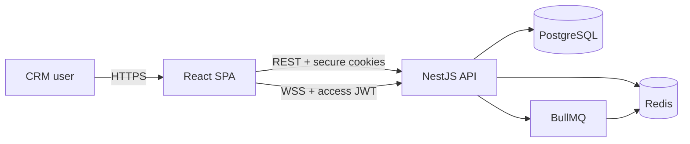
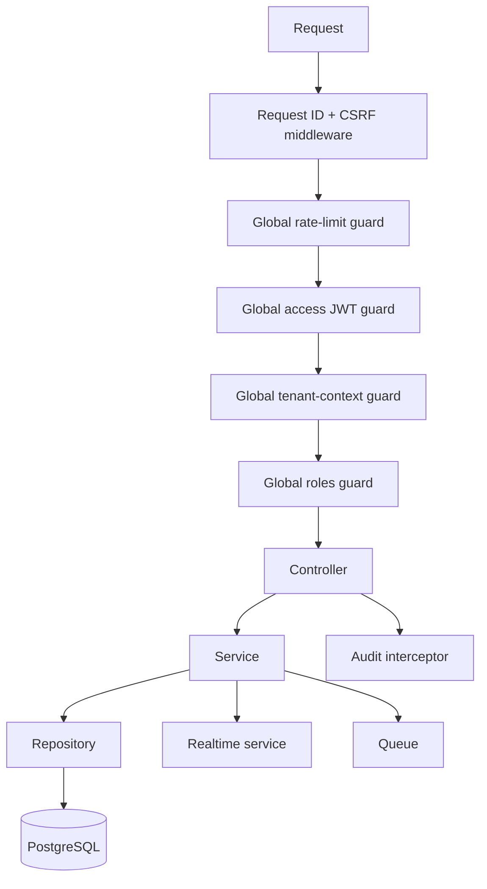

# Architecture

## 1. Purpose and quality priorities

The system is a multi-tenant B2B CRM implemented as a modular monolith. The architecture optimizes
for tenant isolation, secure session handling, traceability, operational simplicity, and the ability
to evolve domains independently before distributed deployment becomes necessary.

Priority order:

1. tenant confidentiality and integrity;
2. authentication and authorization correctness;
3. recoverability and auditability;
4. maintainable module boundaries;
5. predictable performance and horizontal scalability;
6. delivery speed.

## 2. System context

The browser never chooses the authoritative tenant. The API obtains tenant identity from a signed
access token and applies it before domain code runs.

## 3. Deployable units

| Unit | Responsibility | State |
|---|---|---|
| Frontend | Sales workspace, session bootstrap, API orchestration | In-memory access token; CSRF nonce only in browser storage |
| Backend | HTTP API, authorization, domain use cases, audit | Stateless processes plus persisted sessions |
| PostgreSQL | Transactional source of truth | Tenant-scoped CRM records and auth sessions |
| Redis | Rate limits, cache versions, BullMQ transport | Rebuildable operational state |

The BullMQ processor currently runs inside the backend deployment. It can become a separate worker
deployment when queue load or failure isolation requires it.

The backend can be replicated horizontally. Instances share PostgreSQL and Redis. WebSocket fan-out
will require a Socket.IO Redis adapter before multiple realtime instances are enabled.

## 4. Backend component model

Guard order is a security boundary. Public endpoints are exceptions declared with `@Public()`;
omitting authorization metadata cannot accidentally make a controller anonymous.

### Module ownership

| Module | Owns | Allowed collaborators |
|---|---|---|
| `auth` | Login, registration, JWT issuance and browser auth flow | `users`, `tenants`, `sessions`, TypeORM transaction manager |
| `sessions` | Refresh-token hashes, rotation, reuse detection, revocation, active-session checks | No feature repositories |
| `tenants` | Workspace identity and settings | No feature repositories |
| `users` | Membership, roles, account lifecycle | `sessions` for revocation |
| `accounts` | Customer organizations | Redis cache abstraction |
| `contacts` | People and account association | Realtime publisher |
| `deals` | Pipeline, stages, forecast inputs | Tasks for pipeline insights, realtime publisher |
| `tasks` | Activities and reminders | BullMQ, realtime publisher |
| `comments` | Tenant-scoped collaboration and polymorphic target validation | CRM target readers, realtime publisher |
| `audit` | Immutable action history | No feature writes |
| `realtime` | Authenticated tenant rooms and event delivery | `sessions` for active-session checks |

New cross-module behavior should call an exported application service or consume an explicit port.
Direct imports of another module's concrete repository create hidden coupling and are prohibited.
Polymorphic comments resolve their target through exported module services and reject targets that
do not exist inside the authenticated tenant; comment updates cannot change target or author.

## 5. Core flows

### Authenticated HTTP request

1. Middleware assigns a bounded request ID and validates CSRF for unsafe methods.
2. Redis applies the route/IP rate limit.
3. The access strategy validates algorithm, signature, issuer, audience, expiry, and token type.
4. The tenant guard copies tenant identity from the verified principal into request context.
5. RBAC compares endpoint policy with the principal role.
6. Domain queries apply `tenantId` again at the persistence boundary.
7. Successful mutations emit an audit event without sensitive request data.

This is defense in depth: a controller or service should never be able to expand tenant scope using
client input.

### Browser session lifecycle

- Access JWT: short-lived and memory-only.
- Refresh JWT: HttpOnly, Secure in production, SameSite cookie, stored server-side as a bcrypt hash.
- CSRF nonce: double-submit cookie/header; it is not an authentication credential.
- Refresh: serialized with a database row lock, rotates the token, and revokes the session on reuse.
- Password reset, deactivation, and deletion revoke active refresh sessions.

The `sessions` module is the only owner of session persistence. Callers request lifecycle operations
through `SessionsService`; they do not query or update the `auth_sessions` table directly.

### Realtime connection

The gateway validates Origin and the access JWT, checks that the backing session is active and not
expired, derives the room from the JWT tenant, limits message size, disables compression, and closes
the socket when the access token expires. Client-provided room or tenant values are ignored.

## 6. Data architecture

PostgreSQL is the source of truth. Tenant-owned tables carry a non-null UUID `tenantId` and composite
indexes begin with that column for common access paths. UUIDs make identifiers non-sequential but do
not replace authorization.

Rules:

- all queries, mutations, soft deletes, exports, and aggregates are tenant-scoped;
- multi-record invariants use transactions;
- migrations are the only production schema mechanism;
- Redis cache keys and queue job IDs include tenant identity;
- audit data is append-only from application use cases;
- secrets and password hashes are excluded from default selects.

The next data-hardening step is PostgreSQL Row-Level Security as an additional boundary, after
connection/session tenant propagation and migration testing are designed.

## 7. Reliability and observability

- `/health/live` reports process liveness.
- `/health/ready` checks PostgreSQL and Redis dependencies.
- Request IDs are returned to clients and included in audit metadata.
- Redis-dependent rate limiting fails closed with `503` when protection cannot be enforced.
- Queue jobs use deterministic tenant/task IDs to avoid duplicate reminders.

Production evolution should add structured JSON logs, metrics, traces, alerting, automated backups,
restore drills, and dead-letter handling. See `docs/operations/runbook.md`.

## 8. Evolution strategy

Keep the modular monolith while a single team owns the system and cross-domain transactions are
common. Extract a module only when it has clear ownership, an independent scaling profile, a stable
contract, and observable operational pain that isolation solves.

Recommended order:

1. enforce repository ports consistently across every domain;
2. validate cross-entity references within the tenant;
3. add integration tests with PostgreSQL and Redis;
4. introduce an outbox for reliable events;
5. add PostgreSQL RLS defense in depth;
6. add Redis-backed Socket.IO fan-out for horizontal realtime scaling;
7. introduce workflow/automation and external integrations behind dedicated ports;
8. add AI guidance only through audited, permission-aware read models.

## 9. Known architectural risks

- Most domain relationships are UUID fields without database foreign keys.
- Integration and migration tests require a real PostgreSQL/Redis test environment and are not yet
  part of the local unit suite.
- Audit persistence is asynchronous and can fail independently of the business mutation.
- Existing access tokens remain usable until their short expiry after server-side session revocation.
- Realtime fan-out is process-local.
- Backups, metrics, centralized logs, and disaster-recovery automation are deployment concerns not
  yet included in this repository.

These are explicit backlog items, not assumptions hidden in implementation.
